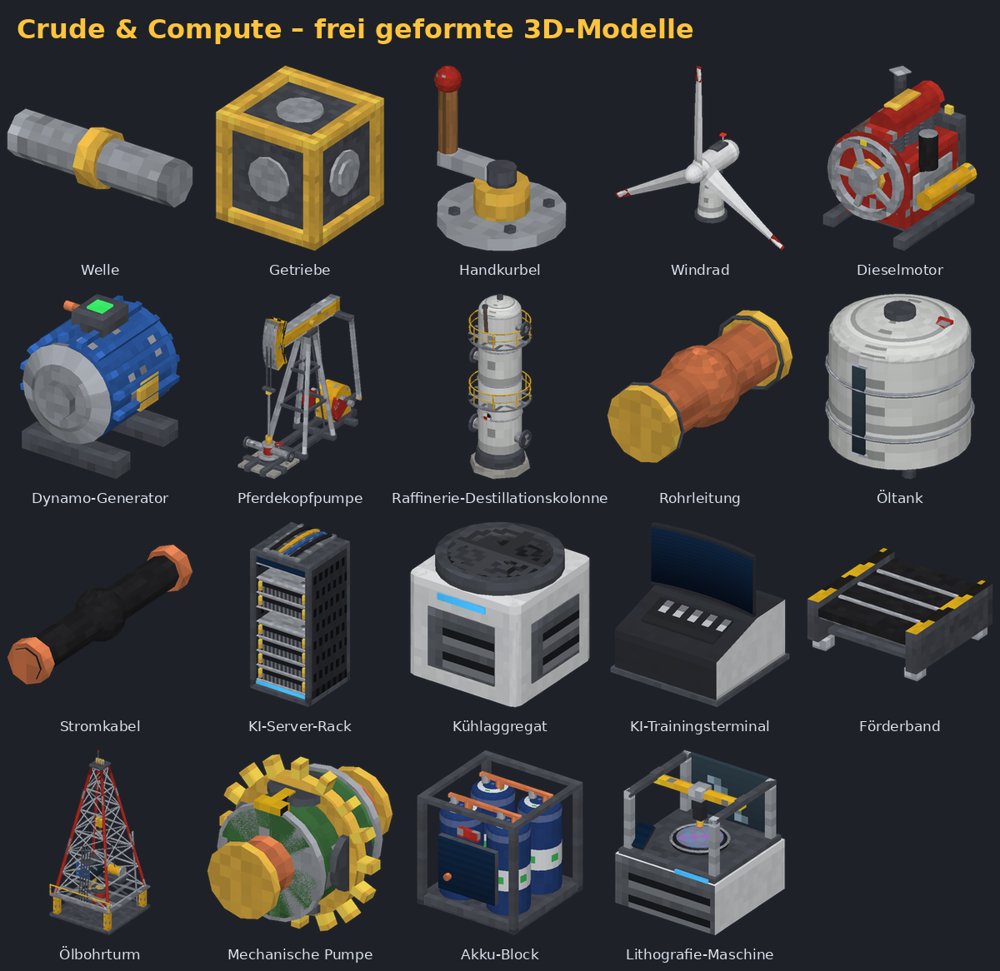
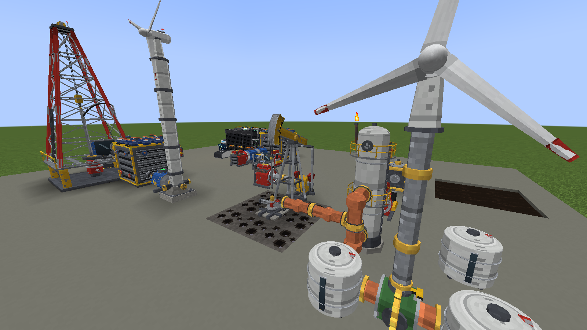
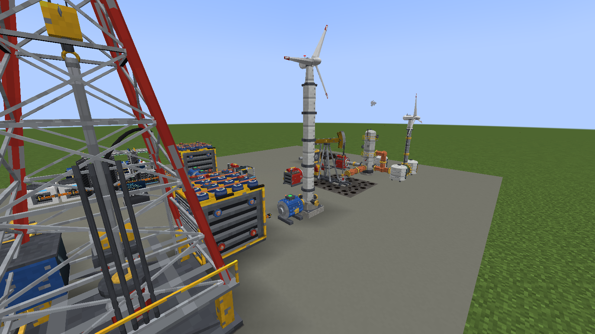
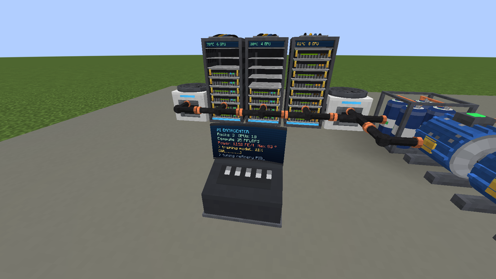
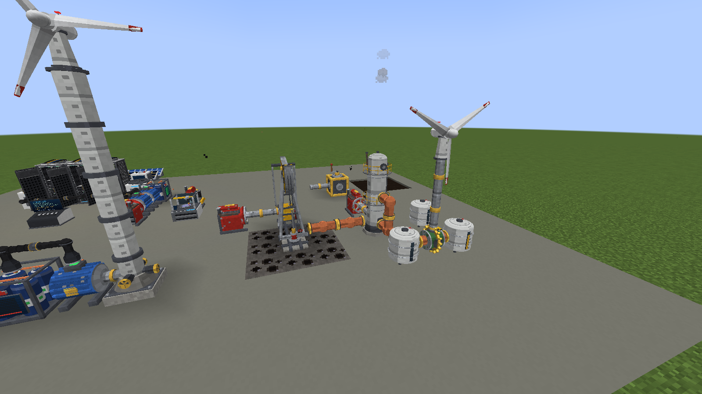

# Crude & Compute – Minecraft-Mod (NeoForge 1.21.1)

Eine Mod im Stil von **Create**: sich drehende Wellen, Getriebe und ein Kraft-/Last-System – dazu eine
komplette **Ölindustrie** (Pferdekopfpumpe, Raffinerie, Dieselmotor) und **KI-Rechenzentrum-Zubehör**
(Server-Racks mit GPUs, Kühlaggregate, KI-Trainingsterminal).

Alle Maschinen sind **frei geformte 3D-Modelle** (OBJ-Meshes mit Zylindern, Kuppeln, gebogenen Rohren,
verdrehten Rotorblättern, gekrümmtem Bildschirm …) – keine Klötzchen. Bewegliche Teile (Wellen, Kurbel,
Balancier mit Pferdekopf, Pleuelstangen, Windrad-Rotor, Schwungrad, Lüfter, GPU-LEDs) werden live animiert.

## So sieht es im Spiel aus
Echte Screenshots aus Minecraft (automatisch per CI aufgenommen, siehe unten):

| | |
|---|---|
|  |  |
|  |  |

## Installation

1. **Minecraft 1.21.1** mit **NeoForge 21.1.x** installieren (Installer: https://neoforged.net).
2. Die Datei [`download/crudecompute-1.21.1-1.2.0.jar`](download/) in den Ordner `.minecraft/mods` legen.
3. Spiel mit dem NeoForge-Profil starten – alles findet sich im Kreativ-Tab **Crude & Compute**.

Die JAR baut GitHub Actions bei jedem Push (Workflow „Minecraft-Mod bauen“, Artefakt
`crude-and-compute-mod`). Enthält die Commit-Nachricht `[showcase]`, startet CI zusätzlich den echten
Minecraft-Client, baut eine Demo-Szene, macht die Screenshots oben und legt sie zusammen mit der JAR in
`docs/screenshots/` und `download/` ab. Selbst bauen: `cd crude-and-compute && ./gradlew build` → `build/libs/`.

## So funktioniert es

### 1. Drehkraft (wie bei Create)
| Block | Funktion |
|---|---|
| **Welle** | überträgt Drehung entlang ihrer Achse |
| **Getriebe** | verbindet Wellen an allen 6 Seiten (Ecken, Abzweige) |
| **Handkurbel** | Rechtsklick = 2 s Drehung: 32 U/min, **64 SU** Kraft |
| **Windrad** | auf eine **senkrechte Welle** setzen, braucht freien Himmel: 16–32 U/min (höher = mehr Wind, Gewitter = mehr), **256 SU** |
| **Dieselmotor** | verbrennt Diesel (1 Eimer ≈ 200 s): 64 U/min, **1024 SU**; Abtrieb am Schwungrad |
| **Dynamo-Generator** | wandelt Drehung in Forge Energy um: 4 FE/t pro U/min, braucht **128 SU** |

Jede Maschine verbraucht **Last (SU)**. Ist die Last im Netz größer als die Kraft aller Antriebe, ist das Netz
**überlastet** und bleibt stehen – genau wie bei Create. Rechtsklick mit leerer Hand zeigt Drehzahl und Last.

### 2. Ölfabrik
1. **Ölschiefer** finden: kommt unterirdisch (Y −48 bis 40) in großen Adern vor; in Wüsten, Badlands,
   Savannen und Ebenen gibt es außerdem **Rohöl-Seen** an der Oberfläche.
2. **Pferdekopfpumpe** (3 Blöcke lang × 3 hoch) so platzieren, dass der **Bohrkopf (vorne)** über Ölschiefer
   steht (irgendwo in der 3×3-Säule darunter). Die Pumpe baut sich in **Blickrichtung** auf.
   Antrieb: Welle **seitlich ins Getriebe** hinten (48 SU). Je mehr Ölschiefer darunter, desto mehr Öl.
3. Rohöl fließt aus dem Bohrkopf (oder Getriebe-Rückseite) in **Rohrleitungen** → **Öltank** (16 Eimer) →
   **Raffinerie-Destillationskolonne** (3 hoch, Drehung am Sockel, 96 SU).
4. Die Raffinerie macht aus 10 mB Rohöl **6 mB Diesel** (kommt aus dem mittleren Block in angeschlossene Rohre)
   und alle 200 mB ein **Kunststoffgranulat** (per Trichter unten oder seitlich abholen).
5. Diesel → **Dieselmotor** → mehr Kraft → mehr Pumpen … der Kreislauf schließt sich.

Eimer funktionieren überall: Rohöl/Diesel per Rechtsklick ein- und ausfüllen.

**Ölbohrturm** (3×3 Grundfläche, 7 Blöcke hoch, Gittermast): fördert **3×** so viel wie die Pferdekopfpumpe
(128 SU, Antrieb per Welle **von hinten**, Tank 32 Eimer). Der Bohrstrang in der Mitte der Fläche muss über
Ölschiefer stehen; der Kronenblock hebt und senkt sich, der Bohrstrang dreht sich. Das Öl fließt in alle
angrenzenden Rohre.

**Förderband:** Items laufen nach vorne (Blickrichtung beim Setzen). Wellen (4 SU) seitlich anschließen. Bänder
reihen sich aneinander, am Ende werden Kisten/Trichter befüllt; Trichter und Wurf-Items werden aufgenommen.

**Mechanische Pumpe:** in eine Rohrleitung setzen (der Pfeil zeigt die Flussrichtung, sie pumpt vom Block
dahinter in den Block davor). Antrieb per Welle von oben, unten oder seitlich (16 SU, 4 mB/t pro U/min).
Damit holt man z. B. Diesel seitlich aus einem Öltank in den Dieselmotor.

### 3. KI-Rechenzentrum
1. **Strom**: Generator → **Stromkabel** → Verbraucher (Forge Energy, kompatibel mit anderen Mods).
   Ein **Akku-Block** (2.000.000 FE) puffert: Er lädt an allen Seiten und gibt nur **vorne** wieder ab –
   die leuchtende Anzeige zeigt den Ladestand, ein Komparator liest ihn aus.
2. **Silizium** aus Quarz schmelzen → **Wafer** → **Platine** (mit Kunststoff) → **KI-Beschleuniger (GPU)**.
   Günstiger geht es mit der **Lithografie-Maschine**: Wafer + Kunststoff + Goldnugget → 2 Platinen, ein
   Laserkopf fährt dabei sichtbar über den Wafer (Antrieb von unten oder hinten, 64 SU; Trichter-kompatibel).
3. **KI-Server-Rack** (2 hoch): mit GPUs rechtsklicken (max. 8, Schleichen+Rechtsklick nimmt eine heraus).
   Jede GPU braucht **64 FE/t**, liefert **2,5 PFLOPS** und heizt das Rack auf.
4. **Kühlaggregat** (16 FE/t) kühlt Racks im Umkreis von 2 Blöcken; Faustregel: **1 Kühler pro 4 GPUs**.
   Ab 80 °C drosselt das Rack (halbe Leistung, gelbe LEDs), ab 100 °C schaltet es ab (rote LEDs, Rauch).
5. **KI-Trainingsterminal**: zeigt live alle Racks im Umkreis von 8 Blöcken (Racks, GPUs, PFLOPS, Strom,
   Temperatur). **Leeres KI-Laufwerk** einlegen → das Rechenzentrum trainiert ein **KI-Modell**
   (8 GPUs ≈ 3–4 Minuten). Fertiges Modell per Rechtsklick herausnehmen.
6. Aus dem trainierten Modell entstehen **KI-Optimierungschips**: auf Pferdekopfpumpe, Raffinerie, Generator
   oder Dieselmotor anwenden → **doppelte Leistung**. Die KI optimiert die Ölförderung!

### Werkzeug
**Schraubenschlüssel**: Rechtsklick dreht Maschinen/Wellen, Schleichen + Rechtsklick baut sie sofort ab.

## Rezepte (Kurzfassung)
| Ergebnis | Zutaten |
|---|---|
| 4 Wellen | 2 Eisenbarren übereinander |
| Getriebe | 4 Wellen um einen Eisenblock |
| Handkurbel | 3 Bretter + Welle |
| Windrad | 4 weiße Wolle, Welle, Eisenbarren |
| Dieselmotor | Eisen, Kolben, Kupfer, Hochofen, Welle |
| Generator | Kupfer, Redstone-Block, Welle, Eisen |
| Pferdekopfpumpe | 7 Eisen, 2 Kolben, Welle, Eimer |
| Raffinerie | 6 Eisen, Kupfer, Eimer, Hochofen |
| 8 Rohre | 3 Kupferbarren in einer Reihe |
| Öltank | 6 Eisen, 2 Kupfer |
| 6 Stromkabel | Kunststoff, Kupfer, Kunststoff |
| Mechanische Pumpe | 2 Kupfer, Rohr, Welle |
| Akku-Block | 4 Kunststoff, 2 Redstone-Blöcke, 2 Kupfer, Eisenblock |
| Lithografie-Maschine | Glasscheiben, Redstone-Lampe, Diamant, Eisen, Welle |
| Silizium | Quarz im Ofen/Hochofen |
| 2 Wafer | 1 Silizium |
| 2 Platinen | Goldnuggets, Redstone, 3 Wafer, 3 Kunststoff |
| GPU | Kupfer, 3 Platinen, Diamant, 3 Kunststoff |
| Server-Rack | Eisen, Eisengitter, Platine |
| Kühlaggregat | Eisen, Kunststoff, Packeis, Platine |
| KI-Terminal | Glasscheiben, Kunststoff, Platine |
| Leeres KI-Laufwerk | Kunststoff, Redstone, Platine |
| 4 KI-Optimierungschips | Gold, Redstone, trainiertes KI-Modell |

Alle Rezepte sind im Spiel per Rezeptbuch (oder JEI/EMI) sichtbar.

## Für Entwickler
* `tools/generate_assets.py` erzeugt **alle** Modelle, Texturen und JSON-Dateien prozedural
  (`python3 tools/generate_assets.py --preview` rendert zusätzlich Vorschaubilder nach `tools/preview/`).
  Die Modelle sind in `tools/models.py` als Python-Code beschrieben (Zylinder, Kegel, Tori, Bézier-Rohre,
  verdrehte Rotorblätter, Kreissegmente …) und werden als OBJ für NeoForges OBJ-Loader exportiert.
* Java-Code in `src/main/java/com/crudecompute`: `kinetic` (Drehkraft-Netz mit Last), `multiblock`,
  `oil`, `datacenter`, `client` (animierte Block-Entity-Renderer).
* `./gradlew runGameTestServer` führt die automatischen Spieltests aus (Kraftnetz, Überlast, Pferdekopfpumpe,
  Multiblock-Abbau, Rechenzentrum, mechanische Pumpe, Akku, Lithografie).
* `./gradlew runClient` startet das Spiel mit der Mod zum Testen, `./gradlew runShowcaseClient` baut
  automatisch die Demo-Szene und macht Screenshots.
